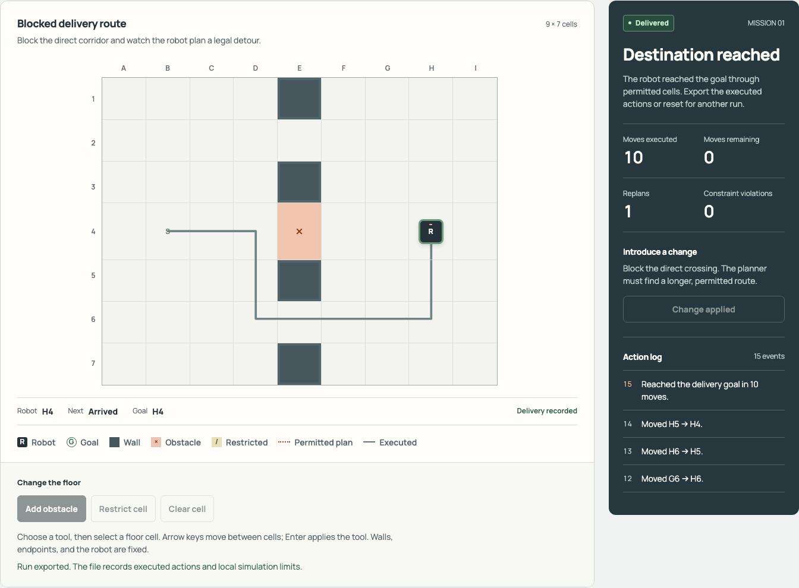

# Route Recovery

Inspect how a delivery recovers when its crossing becomes blocked. Edit a fully known 2D floor, execute a permitted detour or hold position, and export the actual movement history.

This repository contains this product and its required shared modules only. It runs independently of the original four-project suite.

## Run

Requires Node.js 22 or newer. Install the pinned dependencies, then start the loopback-only server:

```sh
npm ci
npm start
```

Open `http://127.0.0.1:4190/` for the landing. The same landing is available at `/products/route`; the working UI is at `/route/`. `DESK_PORT` changes the port. `DESK_WORKSPACE` selects the parent directory of local projects where applicable. Managed records are stored beneath `work/desk` in that workspace; keep this directory private and outside version control.

## Current sponsor workflow

Nemotron chooses follow, hold or operator clearance for the exact reviewed map. Tavily retrieves simulation/navigation references; selected passages feed a separate Nemotron evaluation checklist. Nebius Serverless Jobs evaluates the reviewed state/policy bundle and requires a matching returned report.

Live requests use explicit consent, bounded inputs and a default-deny free-usage guard. See [sponsor setup and receipt boundaries](SPONSORS.md), [recording plan](demo/storyboard.md), and [current release validation](RELEASE-VALIDATION.md). The existing product captures below are historical local observations, not proof of the new sponsor workflow.

## Verify

```sh
npx playwright install chromium
npm test
```

The browser installation is required for browser tests. An already installed browser can instead be selected with `PLAYWRIGHT_CHROMIUM_EXECUTABLE_PATH`. `npm run test:smoke` checks the standalone landing, working UI, evidence assets, session protections, denied sibling routes and unconfigured inference. Tests use local fixtures; no live provider credentials are required. Avoid supplying credentials while testing.

See [selected validation](VALIDATION.md) for the current check scope and results.

## Scope and boundaries

Explore a deterministic synthetic delivery map with bounded recovery decisions and inspectable route evidence. The map is a simulation, not a robotics controller or physical safety guarantee. Optional NVIDIA Nemotron recovery and Nebius AI Cloud Jobs require explicit consent, verified access, configuration and owner review. Cloud Jobs uses separate access-token/profile configuration; no cloud execution occurs merely by opening the page.

No live inference or remote execution was performed by this checkout’s fixture tests; verify release-specific sponsor evidence separately. `.env.example` lists only this product's optional settings. Never commit `.env`, tokens, runtime records or user-selected project files. The server checks exact local Host/Origin, requires a session token for APIs, bounds request size, and serves only explicit static assets. Sibling product pages and APIs are absent.

## Product capture



Actual local simulation: ten moves and one replan; no physical robot or cloud execution.

## Evidence and tests retained

The landing screenshots are actual controlled local UI captures with textual alternatives and image failure fallbacks. JSON evidence is synthetic/controlled and carries its observation limits.

Product unit/service/browser suites and shared inference-runtime tests are retained.   Cross-product hub, marketing, motion, and shared multi-product browser suites are omitted; their route assumptions do not apply to a standalone repository. The standalone smoke suite covers the new server boundary. Historical private audit/output directories and old Git history are intentionally absent.

MIT licensed; the bundled self-hosted Manrope font license is in `src/desk/public/fonts/LICENSE.txt`.
